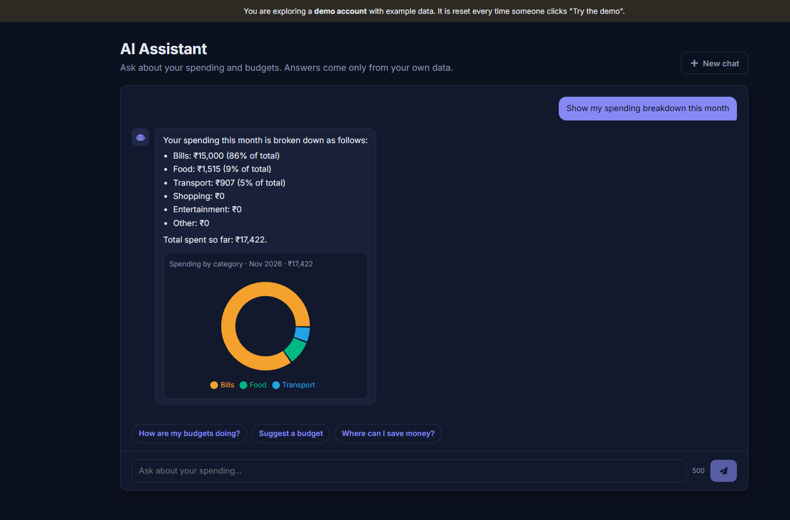
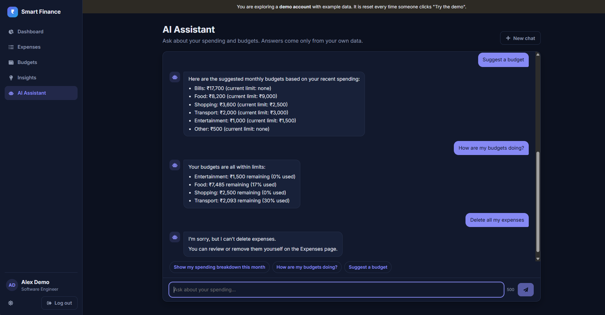
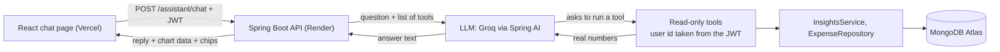

# Smart Finance Assistant 💰

[](https://github.com/Devisri4/smart-finance-assistant/actions/workflows/ci.yml)


A full-stack personal finance app for tracking expenses, setting budgets and getting smart spending insights.

**👉 [Live demo](https://smart-finance-assistant.vercel.app):** click **"Try the demo"** (no sign-up). The first load can take up to a minute while the free server wakes up.

## Features

- Secure sign-up and login (Spring Security, JWT, BCrypt)
- Add, edit, delete, search and filter expenses, with CSV export
- Monthly budgets per category, with alerts at 80% and when over budget
- Smart insights: month-over-month change, top category, month-end projection
- Charts: 6-month trend, category split, this month vs. last month
- Responsive UI with light and dark mode
- One-click demo account with sample data
- **AI Assistant:** chat about your own spending ("Show my spending breakdown this month", "Suggest a budget", "Where can I save money?"). Answers come from your real data through backend tools, with a category chart and quick-question chips inside the chat

## Tech stack

| Layer | Tech |
|---|---|
| Backend | Java 21, Spring Boot 3.5, Spring Security, Spring Data MongoDB, JJWT |
| AI | Spring AI 1.1 (tool calling), Groq free tier via its OpenAI-compatible API |
| Frontend | React 19, React Router, Axios, Recharts |
| Database | MongoDB Atlas |
| Testing / CI | JUnit 5, Mockito, MockMvc, Jest, GitHub Actions |
| Hosting | Render (Docker) for the API, Vercel for the frontend |

## Project structure

```
backend/   Spring Boot REST API (auth, expenses, budgets, insights, demo, AI assistant)
client/    React frontend (dashboard, expenses, budgets, insights, AI assistant)
.github/   CI workflow that builds and tests both on every push
```

## AI Assistant

| Spending breakdown with a chart | Budget suggestions, status and a refused delete |
|---|---|
|  |  |



**How it works.** The model never does the maths. It chooses one of four read-only tools, the Java code runs it, and the model turns the result into a short answer.

| Tool | Wraps |
|---|---|
| `getSpendingSummary` | `InsightsService.insights()`: totals, change vs. last month, projection, categories |
| `getBudgetStatus` | `InsightsService.budgetStatuses()` |
| `suggestBudgets` | `InsightsService.budgetSuggestions()`: 3-month average per category, rounded up to ₹100 |
| `getExpenses` | `ExpenseRepository`, filtered by month or category, at most 20 rows |

**Safety**
- No tool takes a user id. The id comes from the JWT and reaches the tools through Spring AI's `ToolContext`, which is never sent to the model, so one user can't read another's data.
- Chart numbers are taken from the tool result on the server, not from the model's text.
- Read-only: no tool creates, edits or deletes anything.
- Messages are limited to 500 characters. Each user gets 10 messages a minute and 60 a day. The shared demo account is limited per visitor IP (5 a minute, 20 a day), and the whole site has a daily cap.
- 5 s connect and 20 s read timeout, at most one retry, and a friendly message if the AI provider fails.
- The last 10 messages of each conversation are remembered (per user and per chat), so follow-up questions work.

**Setup.** Create a free key at [console.groq.com/keys](https://console.groq.com/keys) and set `AI_API_KEY` on the server (see `backend/.env.example`). Without a key the rest of the app works as usual and the assistant says it isn't set up yet. To switch provider, set `AI_BASE_URL` and `AI_MODEL` to any OpenAI-compatible API (for example Gemini or a local Ollama). No code change is needed.

**Known limitations**
- Groq's free tier allows roughly 8K tokens a minute and 200K a day for the default model. One chat uses a few thousand tokens, so the site-wide cap is 50 messages a day (`AI_DAILY_LIMIT`).
- Rate limits and chat memory live in server memory: they reset when the free server restarts or sleeps, and only work with a single server instance.
- The app only stores expenses and budgets (no income, savings, bills or recurring payments), so saving advice is based on spending patterns only.
- The numbers come from code, but the wording comes from the model, which can still phrase things imperfectly.
- The per-IP demo limit trusts Cloudflare's `CF-Connecting-IP` header, which Render's setup provides. On other hosts, change `app.client-ip-header`.

## Author

**Devi Sri Mudududla** · [GitHub @Devisri4](https://github.com/Devisri4)
