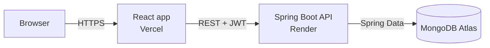

# Smart Finance Assistant 💰

[](https://github.com/Devisri4/smart-finance-assistant/actions/workflows/ci.yml)


A full-stack personal finance app that **tracks expenses, enforces monthly budgets and explains spending habits in plain language**.
Backend in **Java / Spring Boot**, frontend in **React**, data in **MongoDB Atlas**.

### 👉 [Live demo](https://smart-finance-assistant.vercel.app): click **"Try the demo"**, no sign-up needed

> The API runs on a free server that sleeps when idle, so the first request can take up to a minute.

---

## ✨ Features

| | |
|---|---|
| 🔐 **Secure accounts** | Sign up / log in with BCrypt-hashed passwords and stateless JWT authentication (Spring Security). |
| 🧪 **One-click demo** | "Try the demo" opens a ready-made account with four months of realistic data. |
| 🧾 **Expense tracking** | Add, edit and delete expenses; search by title, filter by category and month; export to CSV. |
| 🎯 **Budgets** | Set a monthly limit per category and watch live progress bars. |
| 🚨 **Alerts** | Warnings at 80% of a budget and when a budget is exceeded. |
| 💡 **Smart insights** | Month-over-month comparison (like-for-like to the same day), top category, biggest increase, daily average and month-end projection. |
| 📊 **Charts** | 6-month trend, category doughnut, and this-month vs. last-month comparison. |
| 🌗 **Modern UI** | Responsive sidebar layout with light and dark mode. |
| ✅ **CI** | GitHub Actions builds and tests the backend and the frontend on every push. |

## 🏗 Architecture



```
smart-finance-assistant/
├── backend/                     Spring Boot API (Java 21, Maven)
│   └── src/main/java/com/devisri/finance/
│       ├── auth/                register, login, profile
│       ├── expense/             expense CRUD
│       ├── budget/              budgets and budget status
│       ├── insights/            spending analysis and tips
│       ├── demo/                demo account seeding
│       ├── security/            JWT filter and Spring Security config
│       └── common/              error handling
├── client/                      React frontend
│   └── src/
│       ├── pages/               Dashboard, Expenses, Budgets, Insights, Login, Signup
│       ├── components/          layout, charts, UI building blocks
│       ├── hooks/ utils/        data loading, formatting, filtering, CSV
│       └── api/                 Axios client with JWT interceptor
└── .github/workflows/ci.yml     automated build and tests
```

## 🔌 REST API

All endpoints except the first four need an `Authorization: Bearer <token>` header.

| Method | Path | Description |
|---|---|---|
| GET | `/` | Health check |
| POST | `/register` | Create an account |
| POST | `/login` | Log in, returns a JWT |
| POST | `/demo-login` | Reset and open the demo account, returns a JWT |
| GET | `/profile` | Current user |
| GET / POST | `/expenses` | List / create expenses |
| PATCH / DELETE | `/expenses/{id}` | Update / delete an expense you own |
| GET / PUT | `/budgets` | Budgets with this month's usage / create or update a budget |
| DELETE | `/budgets/{id}` | Remove a budget |
| GET | `/insights` | Totals, trends, alerts and tips for the current month |

## 🧠 Engineering highlights

- **Ownership checks on every query.** Expenses and budgets are always looked up by `id` **and** the logged-in user, so nobody can read or change someone else's data.
- **Whitelisted input.** Request bodies are validated records (`@Valid`). Extra fields such as `user` are ignored.
- **No secrets in code.** The database URI and JWT secret come only from environment variables (see `backend/.env.example`).
- **Testable insights.** The analysis is a pure function with an injectable `Clock`, unit-tested with fixed dates.
- **Fair comparisons.** "Spent more than last month" compares the 1st to today in both months, not a partial month against a full one.
- **Backwards compatible.** Uses the same MongoDB collections and BCrypt hashes as the original Node.js version, so existing accounts keep working.

## 🚀 Run it locally

**Backend** (needs Java 21+ and Maven):

```bash
cd backend
# set these in your terminal first (use your own values, never commit them)
#   MONGO_URI   your MongoDB Atlas connection string
#   JWT_SECRET  any long random text
mvn spring-boot:run          # API on http://localhost:5000
mvn test                     # run the tests
```

**Frontend** (needs Node.js 20+):

```bash
cd client
npm install
npm start                    # app on http://localhost:3000
```

Set `REACT_APP_API_URL` to point the frontend at a different API (defaults to `http://localhost:5000`).

## ☁️ Deployment

- **Frontend:** Vercel, root directory `client`, env var `REACT_APP_API_URL`.
- **Backend:** Render web service from `backend/Dockerfile`, env vars `MONGO_URI`, `JWT_SECRET`, `CORS_ORIGINS`.

## 🛠 Tech stack

**Backend:** Java 21 · Spring Boot 3.5 · Spring Security · Spring Data MongoDB · Bean Validation · JJWT · JUnit 5 · Mockito · MockMvc
**Frontend:** React 19 · React Router 7 · Axios · Recharts · React Icons · React Toastify · Jest
**Infra:** MongoDB Atlas · Render (Docker) · Vercel · GitHub Actions

## 👩‍💻 Author

**Devi Sri Mudududla** · [GitHub @Devisri4](https://github.com/Devisri4)
